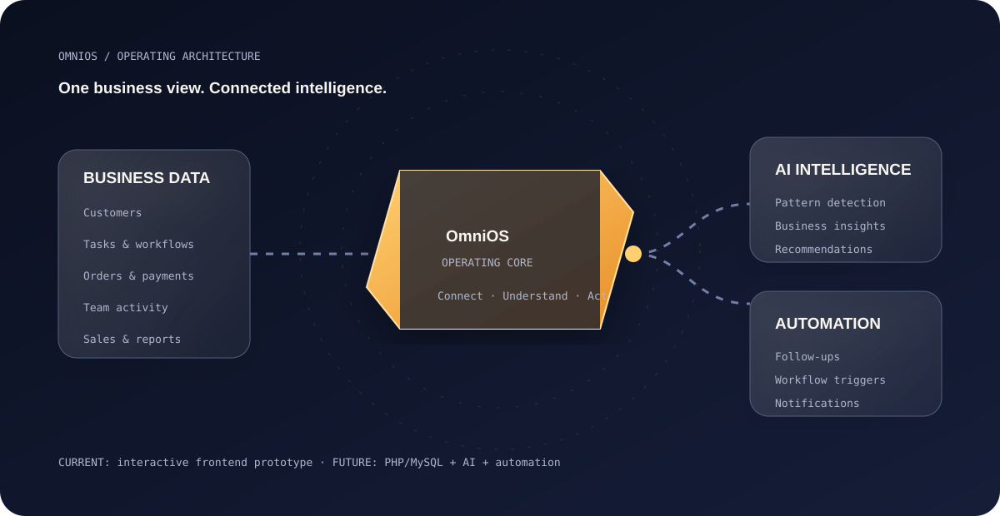

<!-- OmniOS README | Keep claims aligned with the current implementation -->

<div align="center">



# OmniOS

### One workspace. Clearer operations. Better business decisions.

A business operations workspace concept bringing customers, tasks, orders, team activity and business summaries into one consistent experience.

<p>
  <a href="https://omni-os-zeta.vercel.app/"><strong>↗ Live Demo</strong></a>
  &nbsp;·&nbsp;
  <a href="https://github.com/codebynv/OmniOS"><strong>⌘ GitHub Repository</strong></a>
</p>

<p>
  
  
  
  
  
</p>

</div>

---

## The idea

Small businesses often manage customers, follow-ups, orders, team activity and sales information across separate spreadsheets and tools. The result is fragmented information and extra manual coordination.

**OmniOS explores a unified workspace for everyday business operations.** Its longer-term vision is to add an intelligence layer that can help interpret business data, surface useful signals and support repeatable workflows.

> **Project status:** The React frontend is deployed to Vercel. The PHP + MySQL backend is currently intended for local development and has not yet been deployed as a public API. The live demo therefore showcases the frontend; login and database-dependent actions may not work on the public deployment yet.

## Preview the project

| Resource | Link |
|---|---|
| **Live frontend demo** | [omni-os-zeta.vercel.app](https://omni-os-zeta.vercel.app/) |
| **Source code** | [github.com/codebynv/OmniOS](https://github.com/codebynv/OmniOS) |
| **Architecture visual** | [assets/omnios-architecture.svg](assets/omnios-architecture.svg) |

## What is in the current build?

### Workspace experience

- **Dashboard** — business overview and summary visuals.
- **Customers** — customer listing, search and pagination, create, edit and delete.
- **Tasks** — task board and status interactions.
- **Orders** — order overview and fulfilment-oriented demo views.
- **Team** — team directory and filtering.
- **Sales & Analytics** — sample summaries and visualisations.
- **Notifications** — unread/read interactions and notification controls.
- **Settings** — workspace preference controls.

The Customers module is the primary confirmed MySQL-backed CRUD workflow. Several other sections are interactive prototype views; their data persistence varies. Dashboard metrics and analytics visuals may use demonstration data.

### Backend foundation

- PHP API endpoints for customer operations.
- MySQL persistence for owner accounts and customer records used by implemented flows.
- PHP session-based owner authentication.
- Server-side validation and prepared database statements.
- JSON responses for frontend/API communication.

### Product vision — not yet claimed as implemented

- AI-generated business insights and forecasting.
- Automated follow-ups and workflow execution.
- AI assistant, lead scoring and document intelligence.
- Persistent task, order and team modules.
- Role-based access control and broader production operations.

These are future directions, not features to assume are currently live.

## Architecture

```text
┌───────────────────────────────────────┐
│            React + Vite               │
│ Dashboard · Customers · Workspace UI  │
└───────────────────┬───────────────────┘
                    │ HTTP / JSON
                    ▼
┌───────────────────────────────────────┐
│               PHP API                 │
│ Auth · Validation · Business logic    │
└───────────────────┬───────────────────┘
                    │ Prepared SQL
                    ▼
┌───────────────────────────────────────┐
│                MySQL                  │
│ Owner accounts · Customer records     │
└───────────────────────────────────────┘
```

The current repository also preserves the original `frontend/` HTML/CSS/JavaScript prototype. The React application is in `client/`; PHP endpoints are in `api/`; database setup files are in `database/`.

## Tech stack

| Technology | Role |
|---|---|
| React | Component-based user interface |
| Vite | Local development server and production build |
| React Router | Client-side page navigation |
| JavaScript, HTML and CSS | Frontend logic, structure and styling |
| PHP | API endpoints, validation and session-based authentication |
| MySQL | Persistent data for implemented backend flows |
| XAMPP | Local Apache/PHP and MySQL environment |
| Git & GitHub | Version control and source hosting |
| Vercel | Frontend deployment |

## Run OmniOS locally

### Prerequisites

- Node.js and npm
- XAMPP with Apache and MySQL
- Git (optional, if cloning the repository)

### 1. Get the code

```bash
git clone https://github.com/codebynv/OmniOS.git
cd OmniOS
```

### 2. Start the PHP/MySQL environment

1. Place the project under `C:\xampp\htdocs\OmniOS` if using the default XAMPP setup.
2. Start **Apache** and **MySQL** from the XAMPP Control Panel.
3. Set up the database using the SQL file and instructions in the repository.
4. Check the database connection settings in `api/config/db.php`.
5. Use the current `docs/DEMO_GUIDE.md` for local setup and demo-account instructions.

### 3. Start the React frontend

Open a terminal in the project’s `client` directory:

```bash
cd client
npm install
npm run dev
```

Open the local URL printed by Vite, usually [http://localhost:5173](http://localhost:5173).

### 4. Build for deployment

From the `client` directory:

```bash
npm run lint
npm run build
```

Vite writes the production frontend build to `client/dist/`. The PHP API is not executed by Vite and needs a PHP-compatible hosting environment.

## Deployment notes

The frontend is deployed at [https://omni-os-zeta.vercel.app/](https://omni-os-zeta.vercel.app/). Vercel serves the React frontend; it does not automatically host this project’s PHP/MySQL backend.

To make backend-dependent functionality work in production:

1. Deploy the PHP API to a PHP-compatible host.
2. Provision a MySQL database and configure its credentials securely on the server.
3. Configure the frontend to call the deployed API URL.
4. Configure allowed origins, HTTPS, session cookies and other security settings for the production environment.
5. Test login and customer CRUD against the hosted database.

**Do not commit database passwords, production secrets or real user credentials to GitHub.**

## Security and limitations

- Frontend validation is for usability; the backend must validate every request independently.
- Prepared statements help protect database queries involving user input.
- Production use would require a security review covering HTTPS, session-cookie settings, CSRF protection, rate limiting, permissions, logging and backups.
- The example business and records are fictional demonstration data.
- Multi-currency support is not implemented; the workspace uses INR.
- AI automation is a future direction, not a currently running AI service.

## Roadmap

- [x] React workspace frontend and routing
- [x] PHP authentication/session foundation
- [x] PHP + MySQL customer CRUD flow
- [x] Frontend deployment to Vercel
- [ ] Deploy PHP API and MySQL for public use
- [ ] Persist additional modules (tasks, orders and team)
- [ ] Expand permissions, audit history and reporting
- [ ] Explore AI-assisted insights and workflow automation

## Academic context

| | |
|---|---|
| **Project** | OmniOS — Business Operations Management Platform |
| **Student** | Nirav Vala |
| **Programme** | B.Sc. Information Technology |
| **Semester / Division** | Semester III / D |
| **Enrollment number** | 25004500210223 |

## About the project

OmniOS is a student project exploring how a unified business workspace could make common operations easier to navigate. The current implementation focuses on the frontend experience, authentication foundation and customer data workflow, with a clear path for expanding backend persistence and intelligent capabilities.

<div align="center">

**OmniOS**  
*One workspace. Clearer operations. Better business decisions.*

[Open the live demo](https://omni-os-zeta.vercel.app/) · [Explore the code](https://github.com/codebynv/OmniOS)

</div>
